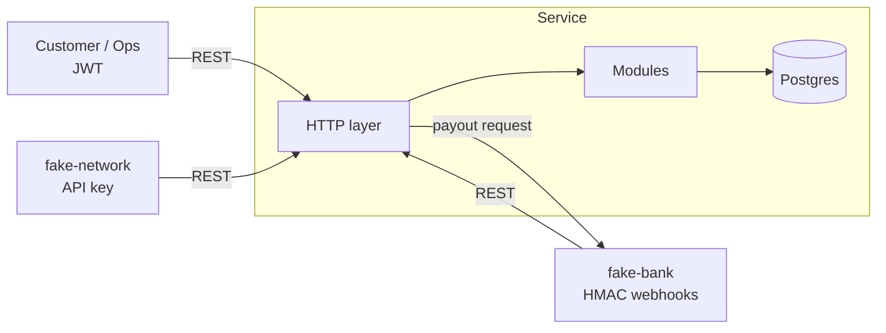
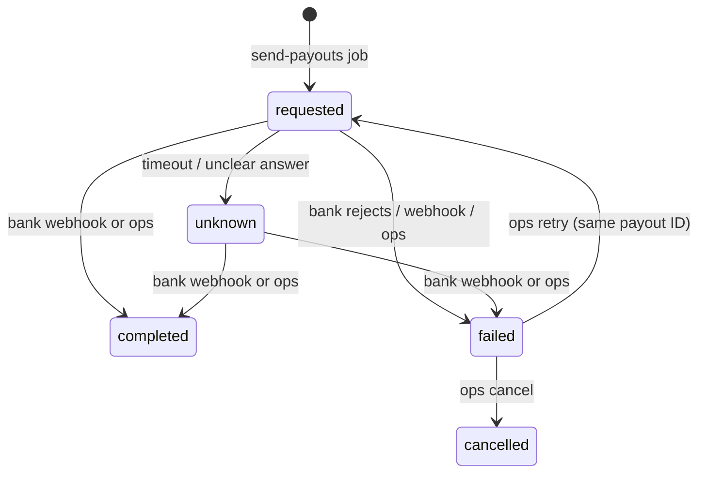
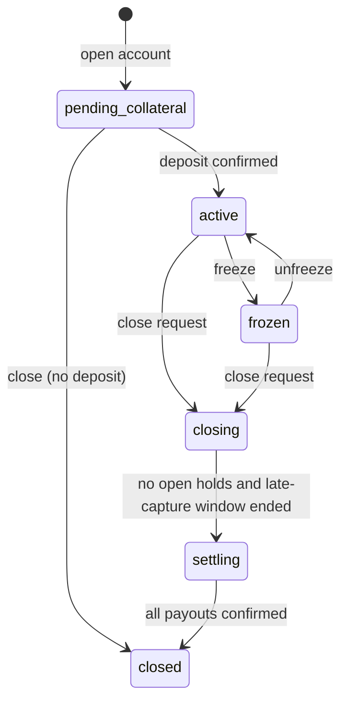

# Architecture

Status: draft. Items marked **OQ-nn** depend on [open-questions.md](open-questions.md).
Answered questions are in [decisions.md](decisions.md).

## 1. Style

The service is one Express app with one Postgres database (a modular monolith).
The code splits by area. The modules do not share tables directly; they call
each other through a module service interface.

**Why one app.** A purchase touches the account, the card, the hold and the
ledger. With one database, one ACID transaction covers all of them. If we split
these areas into separate services, every money movement needs a distributed
transaction (a saga or two-phase commit). That adds failure modes and gives
nothing at this scale. The module boundaries let us extract a service later if
load or team size requires it.

**What is simulated.** Acme does not own the bank, the card network or the
login. The repo holds fakes for them:

- `fake-bank`: sends signed webhooks (deposit, repayment, payout result) and accepts payout requests.
- `fake-network`: calls the authorization, capture, reversal and refund endpoints with its API key.
- `fake-login`: issues test JWTs for `customer` and `ops`.



## 2. Module layout

```
src/
  http/            Express app, middleware (request ID, auth, idempotency, errors)
  modules/
    accounts/      account + card, state machine, freeze, closure
    collateral/    deposits, collateral application, collateral payouts
    spending/      authorizations (holds), captures, reversals, refunds, expiry
    repayments/    repayments, overpayment payouts
    ledger/        chart of accounts, journal posting, balances
    audit/         audit writer
  platform/        db (pool, tx helper), clock, logger, config, money
  fakes/           fake-bank, fake-network, fake-login
  jobs/            hold expiry sweep, closure progression, reconciliation
db/migrations/     numbered SQL files
infra/terraform/   AWS (not applied)
```

Rule: only `ledger/` writes to the ledger tables. Other modules call
`ledger.post(tx, entry)` with the open transaction.

## 3. Data model (sketch)

```sql
accounts (
  id uuid pk, customer_id uuid not null,
  status text not null check (status in
    ('pending_collateral','active','frozen','closing','settling','closed')),
  credit_limit  bigint not null default 0 check (credit_limit >= 0),
  posted_debt   bigint not null default 0,  -- cache of the receivable balance; can exceed the limit (SPEND-06)
  held_total    bigint not null default 0 check (held_total >= 0),
  credit_balance bigint not null default 0 check (credit_balance >= 0),
  version bigint not null default 0,
  closing_started_at timestamptz, created_at timestamptz not null
)
cards (id uuid pk, account_id uuid unique not null, token text unique not null,
       last4 char(4) not null, status text not null check (status in ('inactive','active','blocked')))
holds (id uuid pk, account_id uuid not null, network_auth_id text unique not null,
       amount bigint not null check (amount > 0),
       status text not null check (status in ('open','captured','reversed','expired')),
       expires_at timestamptz not null, created_at timestamptz not null)
authorizations (network_auth_id text pk, card_token text, account_id uuid null, amount bigint, approved bool,
                decline_reason text, hold_id uuid unique, merchant jsonb, decided_at timestamptz)  -- every decision (SPEND-11)
captures (id uuid pk, network_capture_id text unique not null, hold_id uuid, amount bigint check (amount > 0), journal_id uuid not null)
refunds  (id uuid pk, network_refund_id text unique not null, amount bigint check (amount > 0), journal_id uuid not null)
bank_transactions (bank_txn_id text pk, kind text not null, account_id uuid, amount bigint, journal_id uuid, received_at timestamptz)
payouts (id uuid pk, account_id uuid, kind text, amount bigint check (amount > 0),
         status text check (status in ('requested','completed','failed','unknown')),
         bank_txn_id text unique, resolved_by text, resolution_note text)
ledger_accounts (id uuid pk, code text not null, account_id uuid null, normal_side text, unique (code, account_id))
journal_entries (id uuid pk, kind text not null, reverses_id uuid null, request_id text, created_at timestamptz)
journal_lines (id bigserial pk, journal_id uuid not null, ledger_account_id uuid not null, amount bigint not null check (amount <> 0))
idempotency_keys (caller text, key text, request_hash text not null, response_status int, response_body jsonb,
                  created_at timestamptz, primary key (caller, key))
audit_log (id bigserial pk, actor text, action text, entity text, entity_id uuid,
           before jsonb, after jsonb, request_id text, at timestamptz)
```

- A deferred constraint trigger checks that the lines of each journal sum to zero at commit (LEDGER-02).
- A trigger lets a line join only an entry created in the same transaction, so a committed entry never changes (LEDGER-03).
- Timestamps have no `DEFAULT now()`. The app writes them from the clock (OPS-01).
- A trigger rejects `UPDATE` and `DELETE` on `journal_entries`, `journal_lines` and `audit_log` (LEDGER-04, AUDIT-03).
- The app DB role `acme_app` gets `INSERT, SELECT` only on those tables, as a second barrier.
  The migration step creates the role (`ensureAppRole`) and runs as the owner.
- `pg` parses `int8` and `numeric` per pool with a strict safe-integer parser (§4).

**Test strategy.** The tests run against a real Postgres 16. Each run drops and
re-creates `acme_test` and migrates it like production. The ledger cannot be
truncated, so tests never reset data: each test creates and checks its own rows.
A guard test counts only if a mutation of the guard turns it red (see tasks.md).

## 4. Money

- Type: `number`, always an integer count of centavos (MONEY-01).
- `pg` returns `bigint` as a string. A custom type parser converts it and throws
  if the value is not `Number.isSafeInteger` (max 2^53−1 centavos ≈ 90 trillion MXN).
- Input: zod `z.number().int().positive().max(MAX_AMOUNT_CENTAVOS)`. A JSON string or a decimal is rejected (MONEY-02).
- No division or multiplication happens on amounts in the core flows. If an
  extra (interest) needs one, it uses an explicit rounding rule documented here first.

## 5. Ledger

Sign convention: debit = positive, credit = negative. Each journal sums to zero,
so the whole ledger sums to zero.

**Chart of accounts**

| Code | Owner | Type | Meaning |
|---|---|---|---|
| `cash_collateral` | system | asset | Bank cash held as collateral (segregated). |
| `cash_operating` | system | asset | Operating bank cash. |
| `network_payable` | system | liability | What Acme owes the card network for captures. |
| `chargeoff_loss` | system | expense | Debt that collateral did not cover (CLOSE-07). |
| `unapplied_funds` | system | liability | Money that landed with an unknown reference. Ops resolves it (COL-08). |
| `customer_collateral` | per account | liability | Collateral Acme owes back to the customer. |
| `customer_receivable` | per account | asset | What the customer owes for purchases. |
| `customer_credit` | per account | liability | Overpayments and excess refunds owed to the customer. |

**Journal templates**

| Event | Debit | Credit |
|---|---|---|
| Deposit confirmed (`pending_collateral`, at or above minimum) | `cash_collateral` | `customer_collateral` |
| Deposit to a collateral reference, any other state or below minimum | `cash_collateral` | `customer_credit` |
| Deposit, unknown reference | `cash_operating` | `unapplied_funds` |
| Charge-off of uncovered debt | `chargeoff_loss` | `customer_receivable` |
| Capture | `customer_receivable` | `network_payable` |
| Refund (up to debt) | `network_payable` | `customer_receivable` |
| Refund (excess) | `network_payable` | `customer_credit` |
| Repayment (up to debt) | `cash_operating` | `customer_receivable` |
| Repayment (excess) | `cash_operating` | `customer_credit` |
| Apply collateral to debt | `customer_collateral` + `cash_operating` | `customer_receivable` + `cash_collateral` |
| Collateral payout completed | `customer_collateral` | `cash_collateral` |
| Credit payout completed | `customer_credit` | `cash_operating` |
| Return payout completed (credited deposit) | `customer_credit` | `cash_collateral` |
| Credit netting (PAYOUT-10) | `customer_credit` | `customer_receivable` |

Cached counters on `accounts`: `credit_limit` = balance of `customer_collateral`,
`posted_debt` = balance of `customer_receivable`, `credit_balance` = balance of
`customer_credit`. The reconciliation command (OPS-03) recomputes them.

**Payouts.** A payout posts to the ledger only when it is `completed`. Until
then the money stays reserved: the account stays in `settling` (closure), or the
credit balance stays reserved (overpayment).



- The service never retries a payout on its own (PAYOUT-03). A timeout is
  `unknown`, because the bank may have paid. A blind retry can pay twice.
- Each bank request carries the payout ID as its idempotency key (PAYOUT-06). So
  if ops decides to retry, the bank can still dedupe.
- An ops resolution writes an audit row with the evidence reference (PAYOUT-04).
- **Credit buckets.** `credit_balance` splits into *returnable* (cash in
  `cash_collateral`, from a credited deposit: goes back as a `return` payout,
  never nets) and the rest. Of the rest, money in an open credit payout is
  reserved; what is left is *free* and nets against new debt at capture time
  (PAYOUT-10). Netting stops the moment the job creates a payout.
- **Known gaps for ops.** A payout stuck in `requested` with no `submitted_at`
  (the process died between commit and the bank call) appears in
  `GET /v1/ops/payouts?status=requested`; nothing resends it. A cancelled
  `return` keeps its credit returnable and is not re-created; a person decides.
- A late bank webhook resolves a payout only while it is `unknown` (PAYOUT-08).
  After a person resolved it, the webhook changes nothing; a different result
  raises a mismatch flag for ops (PAYOUT-09).

## 6. State machine



| State | Authorize | Capture / reverse / refund | Repayment | Deposit |
|---|---|---|---|---|
| `pending_collateral` | decline | n/a | credit + payback | accept (COL-09 if below minimum) |
| `active` | approve if funds | post | post | credit + payback |
| `frozen` | decline | post | post | credit + payback |
| `closing` | decline | post | post | credit + payback |
| `settling` | decline | post (CLOSE-08) | post | credit + payback |
| `closed` | decline | post (CLOSE-08) | post (CLOSE-08) | credit + payback |

The domain layer checks each transition against an allow-list. The `status`
CHECK constraint is the second barrier.

## 7. Concurrency

Every write that touches an account runs this pattern (P6):

```
BEGIN                                         -- READ COMMITTED
INSERT idempotency key ... ON CONFLICT DO NOTHING   -- parallel duplicate blocks here
SELECT ... FROM accounts WHERE id = $1 FOR UPDATE   -- all writers on the account serialise here
expire overdue holds of this account (lazy expiry, SPEND-09)
check the rule (state, available credit)
INSERT hold / journal / audit; UPDATE accounts counters
UPDATE idempotency key with the response
COMMIT
```

- **Authorization** (`POST /v1/network/authorizations`): advisory lock on the
  `network_auth_id`, stored decision lookup, card token → account, account row
  lock, lazy hold expiry, then the checks in this order: account `active`, card
  `active`, amount ≤ `MAX_AMOUNT_CENTAVOS`, amount ≤ available credit. Every
  decision is stored in `authorizations`; only an approval creates a hold.
- **Capture / refund**: advisory lock on the network capture or refund ID,
  stored-result lookup, card token → account row lock, lazy expiry, then the
  hold row (`FOR UPDATE`). Only an open hold is released and linked; anything
  else still posts. A refund reduces `posted_debt` first and credits the rest.
- **Reversal**: authorization → account row lock → hold row lock. The account
  lock matters even though the hold lock serialises capture vs reversal: without
  it a reversal racing a new authorization overwrites `held_total` (lost update).
- Lock order is always: idempotency key (or the network/bank ID advisory lock), then account row, then hold row. One account per
  transaction. So no deadlock between two money calls.
- The account row lock is the guard for SPEND-03. The test fires 20 parallel
  authorizations whose sum exceeds the limit and asserts that
  `sum(approved) <= limit` and `held_total` equals the sum of open holds.
- **Deliberate trade-off: no DB constraint on the limit.** A CHECK
  `posted_debt + held_total <= credit_limit` is not possible, because SPEND-06
  allows a capture over the limit (we can decline an authorization, never a
  capture). The DB enforces `held_total >= 0` and `amount > 0`. The over-limit
  rule for authorizations lives in the locked transaction, and the concurrency
  test plus its mutation check (remove `FOR UPDATE`, see red) prove it.

## 8. Idempotency

Two mechanisms, one per caller type:

| Caller | Key | Store |
|---|---|---|
| Customer, ops | `Idempotency-Key` header, scoped per caller | `idempotency_keys` |
| Card network | `network_auth_id`, `network_capture_id`, `network_refund_id` | unique columns |
| Bank | `bank_txn_id` | `bank_transactions` primary key, behind a transaction-scoped advisory lock on the ID |

**Bank transfers.** The bank sends one event type for all incoming money,
`transfer.received`, with the reference the customer paid to. SPEI money has no
"purpose", so the reference decides (OQ-07): the collateral reference goes to
the deposit flow, the repayment reference to the repayment flow (M6), and an
unknown reference to `unapplied_funds`. The handler takes
`pg_advisory_xact_lock(hash(bank_txn_id))` first, then the account row lock. A
parallel duplicate waits on the advisory lock and then reads the stored
outcome. The app role has no UPDATE on `bank_transactions`, so the row is
written once, at the end, with its outcome and journal.

For the header flow, the key row goes in first inside the transaction. A
parallel request with the same key blocks on the primary key until the first
commits, then reads the stored response (IDEM-05). A different body hash
returns 422 (IDEM-04). A network or bank duplicate returns the first result.

## 9. Security

| Caller | Mechanism | Endpoints |
|---|---|---|
| Customer | JWT (HS256, test secret from `fake-login`), `role=customer`, `sub` = customer ID | `/v1/accounts/...` |
| Ops | JWT, `role=ops` | `/v1/ops/...` |
| Card network | `X-Network-Key` header, constant-time compare | `/v1/network/...` |
| Bank | `X-Bank-Signature: t=<ts>,v1=<hmac>` over `<ts>.<raw body>`, 5 min window, constant-time compare | `/v1/bank/webhooks` |

- Ownership: the account query always filters by `customer_id = sub`. A miss is 404, not 403, so an attacker cannot probe account IDs (SEC-02).
- Card data: we store the network token and `last4` only (SEC-05).
- Secrets come from env vars. In AWS they come from Secrets Manager.

## 10. API (first cut)

| Method | Path | Caller |
|---|---|---|
| POST | `/v1/accounts` | customer |
| GET | `/v1/accounts/:id` | customer, ops |
| GET | `/v1/accounts/:id/transactions` | customer, ops |
| POST | `/v1/accounts/:id/close` | customer, ops |
| POST | `/v1/accounts/:id/freeze`, `/unfreeze` | customer, ops (backlog) |
| POST | `/v1/network/authorizations` | network |
| POST | `/v1/network/authorizations/:networkAuthId/reversal` | network |
| POST | `/v1/network/captures` | network (`networkAuthId` optional: force post) |
| POST | `/v1/network/refunds` | network |
| GET | `/v1/accounts` | customer (own accounts only) |
| POST | `/v1/bank/webhooks` | bank (`transfer.received`; M6 adds `payout.completed`, `payout.failed`) |
| GET | `/v1/ops/payouts?status=…&mismatch=…&accountId=…` | ops |
| POST | `/v1/ops/payouts/:id/resolve` | ops |
| GET | `/v1/ops/unapplied-funds` | ops |

## 11. Background jobs

All jobs read the injectable clock and take the account lock like any other writer.

- Run with `npm run job -- <name>` locally, `node dist/jobs/cli.js <name>` in a container.
- `send-payouts`: creates the due `return` and `credit` payouts per account (one transaction each, under the account lock), then sends each one after commit.
- `expire-holds`: marks overdue holds `expired` and lowers `held_total`. The authorize path also expires holds lazily, so correctness does not depend on the job. Until the job runs, `GET /v1/accounts/:id` can show an overdue hold in `heldTotal`; the next authorization never sees it.
- `progress-closures`: moves `closing` → `settling`, posts the collateral application, requests the payouts.
- `reconcile`: OPS-03.

## 12. Deployment (AWS, not applied)

Terraform in `infra/terraform/`: VPC with private subnets, ECS Fargate service
behind an ALB, RDS Postgres (Multi-AZ, encrypted, automated backups), Secrets
Manager for the JWT secret, network key and bank HMAC secret, CloudWatch logs.
Migrations run as a one-off ECS task before the service update. Details come in
milestone M9.
