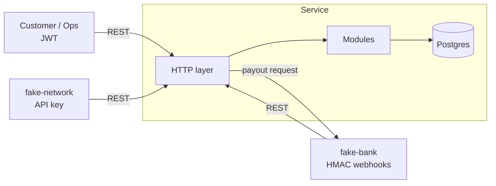
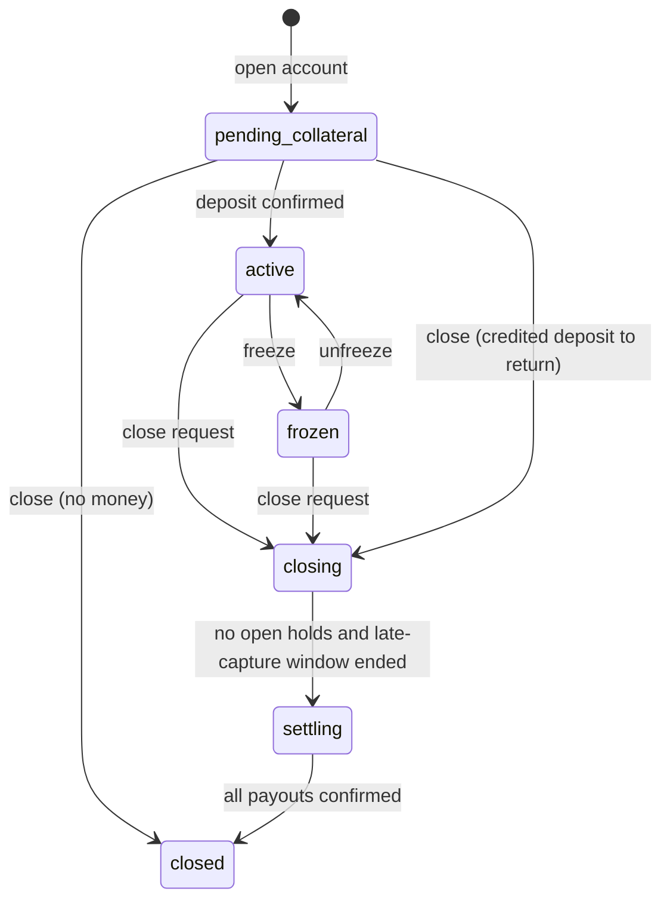

# Architecture

Status: draft. Items marked **OQ-nn** depend on [open-questions.md](open-questions.md).
Answered questions are in [decisions.md](decisions.md).

## 1. Style

The service is one Express app with one Postgres database (a modular monolith).
The code splits by area. The modules do not share tables directly; they call
each other through a module service interface.

**Why one app.** A purchase touches the account, the card, the hold and the
ledger. With one database, one ACID transaction covers all of them. If we split
these areas into separate services, every money movement needs a distributed
transaction (a saga or two-phase commit). That adds failure modes and gives
nothing at this scale. The module boundaries let us extract a service later if
load or team size requires it.

**What is simulated.** Acme does not own the bank, the card network or the
login. The repo holds fakes for them:

- `fake-bank`: sends signed webhooks (deposit, repayment, payout result) and accepts payout requests.
- `fake-network`: calls the authorization, capture, reversal and refund endpoints with its API key.
- `fake-login`: issues test JWTs for `customer` and `ops`.



## 2. Module layout

```
src/
  http/            Express app, middleware (request ID, auth, idempotency, errors)
  modules/
    accounts/      account + card, state machine, freeze, closure
    collateral/    deposits, collateral application, collateral payouts
    spending/      authorizations (holds), captures, reversals, refunds, expiry
    repayments/    repayments, overpayment payouts
    ledger/        chart of accounts, journal posting, balances
    audit/         audit writer
  platform/        db (pool, tx helper), clock, logger, config, money
  fakes/           fake-bank, fake-network, fake-login
  jobs/            hold expiry sweep, closure progression, reconciliation
db/migrations/     numbered SQL files
infra/terraform/   AWS (not applied)
```

Rule: only `ledger/` writes to the ledger tables. Other modules call
`ledger.post(tx, entry)` with the open transaction.

## 3. Data model

Source of truth: `db/migrations/001..008`. The runner refuses an edited applied migration and one that sorts before an applied one (OPS-07). Summary (CHECKs abbreviated):

```sql
accounts (id uuid pk, customer_id uuid,           -- one non-closed account per customer (partial unique index)
  status text check (pending_collateral|active|frozen|closing|settling|closed),
  -- cached balances; reconcile recomputes them (OPS-03)
  credit_limit bigint >= 0,                        -- = customer_collateral balance (Q16: 1:1)
  posted_debt bigint >= 0,                         -- = customer_receivable; may exceed the limit (SPEND-06)
  held_total bigint >= 0,                          -- = sum of open holds
  credit_balance bigint >= 0,                      -- = customer_credit
  credit_returnable bigint >= 0, <= credit_balance -- credited deposits, returned, never netted (D-M6-1)
  charged_off_outstanding bigint >= 0,             -- owed after charge-off (CLOSE-07/09)
  collateral_reference text unique, repayment_reference text unique,   -- OQ-07
  payout_clabe text,                               -- D-M6-3
  version bigint, activated_at, closing_started_at, created_at, updated_at timestamptz)
cards (id, account_id unique, token unique, last4 char(4), status inactive|active|blocked)
holds (id, account_id, network_auth_id unique, amount > 0,
       status open|captured|reversed|expired, expires_at, created_at, closed_at)
authorizations (network_auth_id pk, card_token, account_id null, amount, approved,
                decline_reason, hold_id unique, merchant jsonb, decided_at)       -- every decision (SPEND-11)
captures (id, network_capture_id unique, account_id, hold_id unique null, network_auth_id,
          card_token, amount > 0, journal_id, created_at)
refunds (id, network_refund_id unique, network_capture_id, account_id, card_token, amount > 0,
         debt_reduced, recovered, credited, journal_id, created_at)              -- the three parts = amount
bank_transactions (bank_txn_id pk, kind deposit|payout_result, reference, account_id, amount,
                   outcome (closed list), journal_id, received_at)               -- COL-03 dedupe
payouts (id, account_id, kind collateral|credit|return, amount > 0,
         status requested|completed|failed|unknown|cancelled, source_cash, destination_clabe,
         return_of -> bank_transactions (unique while not released), submitted_at, released_at,
         bank_txn_id unique, journal_id,
         resolved_by, resolution_note, mismatch, created_at, updated_at)        -- completed <=> journal_id
charge_offs (id, account_id, kind charge_off|recovery, amount > 0, journal_id, created_at)   -- append-only by grant
ledger_accounts (id, code (closed list), account_id null for system, type asset|liability|expense,
                 unique nulls not distinct (code, account_id))
journal_entries (id, kind, account_id, reverses_id, request_id, created_at, created_txid xid8)
journal_lines (id bigserial, journal_id, ledger_account_id, amount <> 0)        -- debit > 0, credit < 0
idempotency_keys (caller, key, request_hash, response_status, response_body jsonb,
                  created_at, completed_at, pk (caller, key))
audit_log (id bigserial, actor_type, actor_id, action, entity_type, entity_id,
           before jsonb, after jsonb, request_id, at)
schema_migrations (version pk, checksum, applied_at)                             -- edited migration = startup error
```

- A deferred constraint trigger checks that the lines of each journal sum to zero at commit (LEDGER-02).
- A trigger lets a line join only an entry created in the same transaction, so a committed entry never changes (LEDGER-03).
- Timestamps have no `DEFAULT now()`. The app writes them from the clock (OPS-01).
- A trigger rejects `UPDATE`, `DELETE` and `TRUNCATE` on `journal_entries`, `journal_lines` and `audit_log` (LEDGER-04, AUDIT-03). The table owner can disable a trigger, so the trigger alone does not bind the owner; the app never connects as the owner (migration 008 records this on the function).
- The app DB role `acme_app` gets `INSERT, SELECT` only on those tables, as a second barrier.
  The migration step creates the role (`ensureAppRole`) and runs as the owner.
- `pg` parses `int8` and `numeric` per pool with a strict safe-integer parser (§4).

**Test strategy.** The tests run against a real Postgres 16. Each run drops and
re-creates `acme_test` and migrates it like production. The ledger cannot be
truncated, so tests never reset data: each test creates and checks its own rows.
Checks that take table-wide locks run in `acme_test_isolated`, a migrated copy
with no traffic (D-M6-5). A guard test counts only if a mutation of the guard
turns it red (see tasks.md).

## 4. Money

- Type: `number`, always an integer count of centavos (MONEY-01).
- `pg` returns `bigint` as a string. A custom type parser converts it and throws
  if the value is not `Number.isSafeInteger` (max 2^53−1 centavos ≈ 90 trillion MXN).
- Input: zod `z.number().int().positive().max(MAX_AMOUNT_CENTAVOS)`. A JSON string or a decimal is rejected (MONEY-02).
- No division or multiplication happens on amounts in the core flows. If an
  extra (interest) needs one, it uses an explicit rounding rule documented here first.

## 5. Ledger

Sign convention: debit = positive, credit = negative. Each journal sums to zero,
so the whole ledger sums to zero.

**Chart of accounts**

| Code | Owner | Type | Meaning |
|---|---|---|---|
| `cash_collateral` | system | asset | Bank cash held as collateral (segregated). |
| `cash_operating` | system | asset | Operating bank cash. |
| `network_payable` | system | liability | What Acme owes the card network for captures. |
| `chargeoff_loss` | system | expense | Debt that collateral did not cover (CLOSE-07). |
| `unapplied_funds` | system | liability | Money that landed with an unknown reference. Ops resolves it (COL-08). |
| `customer_collateral` | per account | liability | Collateral Acme owes back to the customer. |
| `customer_receivable` | per account | asset | What the customer owes for purchases. |
| `customer_credit` | per account | liability | Overpayments and excess refunds owed to the customer. |

**Journal templates**

| Event | Debit | Credit |
|---|---|---|
| Deposit confirmed (`pending_collateral`, at or above minimum) | `cash_collateral` | `customer_collateral` |
| Deposit to a collateral reference, any other state or below minimum | `cash_collateral` | `customer_credit` |
| Deposit, unknown reference | `cash_operating` | `unapplied_funds` |
| Charge-off of uncovered debt | `chargeoff_loss` | `customer_receivable` |
| Recovery of charged-off debt by repayment (CLOSE-09) | `cash_operating` | `chargeoff_loss` |
| Recovery by refund (B2) | `network_payable` | `chargeoff_loss` (then receivable / credit for the rest) |
| Recovery by collateral-reference deposit (B3) | `cash_collateral` | `chargeoff_loss` (rest to `customer_credit`, returned) |
| Recovery from collateral that came back (A1) | `customer_collateral` + `cash_operating` | `chargeoff_loss` + `cash_collateral` |
| Collateral payout completed | `customer_collateral` | `cash_collateral` |
| Capture | `customer_receivable` | `network_payable` |
| Refund (up to debt) | `network_payable` | `customer_receivable` |
| Refund (excess) | `network_payable` | `customer_credit` |
| Repayment (up to debt) | `cash_operating` | `customer_receivable` |
| Repayment (excess) | `cash_operating` | `customer_credit` |
| Apply collateral to debt | `customer_collateral` + `cash_operating` | `customer_receivable` + `cash_collateral` |
| Collateral payout completed | `customer_collateral` | `cash_collateral` |
| Credit payout completed | `customer_credit` | `cash_operating` |
| Return payout completed (credited deposit) | `customer_credit` | `cash_collateral` |
| Credit netting (PAYOUT-10) | `customer_credit` | `customer_receivable` |

Cached counters on `accounts`: `credit_limit` = balance of `customer_collateral`,
`posted_debt` = balance of `customer_receivable`, `credit_balance` = balance of
`customer_credit`. The reconciliation command (OPS-03) recomputes them.

**Payouts.** A payout posts to the ledger only when it is `completed`. Until
then the money stays reserved: the account stays in `settling` (closure), or the
credit balance stays reserved (overpayment).

```mermaid
stateDiagram-v2
  [*] --> requested: send-payouts job
  requested --> completed: bank webhook or ops
  requested --> failed: bank rejects / webhook / ops
  requested --> unknown: timeout / unclear answer
  unknown --> completed: bank webhook or ops
  unknown --> failed: bank webhook or ops
  failed --> requested: ops retry (same payout ID)
  failed --> cancelled: ops cancel (money parked)
  failed --> cancelled: system, collateral needed for debt (released at once, A1)
  cancelled --> cancelled: ops release (parking ends; jobs pay again)
```



- The service never retries a payout on its own (PAYOUT-03). A timeout is
  `unknown`, because the bank may have paid. A blind retry can pay twice.
- Each bank request carries the payout ID as its idempotency key (PAYOUT-06). So
  if ops decides to retry, the bank can still dedupe.
- An ops resolution writes an audit row with the evidence reference (PAYOUT-04).
- **Credit buckets.** `credit_balance` splits into *returnable* (cash in
  `cash_collateral`, from a credited deposit: goes back as a `return` payout,
  never nets) and the rest. Of the rest, money in an open credit payout is
  reserved; what is left is *free* and nets against new debt at capture time
  (PAYOUT-10). Netting stops the moment the job creates a payout.
- **Parking (OQ-13, PAYOUT-15).** A payout holds its money while `requested`,
  `unknown`, `failed`, or `cancelled` and not yet released. Held money does not
  net, is not paid out again and keeps the account from closing. Ops releases a
  parked payout (`POST /v1/ops/payouts/:id/release`), optionally with a new
  payout CLABE; released credit first nets against debt, then the jobs create a
  fresh payout (a new ID). A released return no longer blocks a new return of
  the same deposit (partial unique index on `return_of`).
- **Sending (PAYOUT-17).** `submit` claims the payout with one
  `UPDATE … WHERE submitted_at IS NULL` before the bank call, so concurrent
  senders make one bank request. A crash after the claim shows as
  `no_bank_result` in the stuck list; nothing resends it.
- A late bank webhook resolves a payout only while it is `requested` or `unknown` (PAYOUT-08).
  After a person resolved it, the webhook changes nothing; a different result
  raises a mismatch flag for ops (PAYOUT-09).

## 6. State machine



| State | Authorize | Capture / reverse / refund | Repayment | Deposit |
|---|---|---|---|---|
| `pending_collateral` | decline | n/a | credit + payback | accept (COL-09 if below minimum) |
| `active` | approve if funds | post | post | credit + payback |
| `frozen` | decline | post | post | credit + payback |
| `closing` | decline | post | post | credit + payback |
| `settling` | decline | post (CLOSE-08) | post | credit + payback |
| `closed` | decline | post (CLOSE-08) | post (CLOSE-08) | credit + payback |

The domain layer checks each transition against an allow-list. The `status`
CHECK constraint is the second barrier.

## 7. Concurrency

Every write that touches an account runs this pattern (P6):

```
BEGIN                                         -- READ COMMITTED
INSERT idempotency key ... ON CONFLICT DO NOTHING   -- or: advisory lock on the network/bank ID
SELECT ... FROM accounts WHERE id = $1 FOR UPDATE   -- all writers on the account serialise here
expire overdue holds of this account          -- only where the decision reads held_total (below)
check the rule (state, available credit)
INSERT hold / journal / audit; UPDATE accounts counters
UPDATE idempotency key with the response
COMMIT
```

- **Lazy hold expiry** (SPEND-09) runs in the paths whose decision depends on
  `held_total`: authorize, capture, reversal, closure progress, and the sweep
  job. Deposits, repayments, refunds and payout results do not read it, so
  they skip it; an overdue hold they leave in place is expired by the next of
  those paths.
- **Authorization** (`POST /v1/network/authorizations`): advisory lock on the
  `network_auth_id`, stored decision lookup, card token → account, account row
  lock, lazy hold expiry, then the checks in this order: account `active`, card
  `active`, amount ≤ `MAX_AMOUNT_CENTAVOS`, amount ≤ available credit. Every
  decision is stored in `authorizations`; only an approval creates a hold.
- **Capture / refund**: advisory lock on the network capture or refund ID,
  stored-result lookup, card token → account row lock, lazy expiry, then the
  hold row (`FOR UPDATE`). Only an open hold is released and linked; anything
  else still posts. A refund reduces `posted_debt` first and credits the rest.
- **Reversal**: authorization → account row lock → hold row lock. The account
  lock matters even though the hold lock serialises capture vs reversal: without
  it a reversal racing a new authorization overwrites `held_total` (lost update).
- Lock order is always: idempotency key (or the network/bank ID advisory lock), then account row, then hold row. One account per
  transaction. So no deadlock between two money calls.
- The account row lock is the guard for SPEND-03. The test fires 20 parallel
  authorizations whose sum exceeds the limit and asserts that
  `sum(approved) <= limit` and `held_total` equals the sum of open holds.
- **Deliberate trade-off: no DB constraint on the limit.** A CHECK
  `posted_debt + held_total <= credit_limit` is not possible, because SPEND-06
  allows a capture over the limit (we can decline an authorization, never a
  capture). The DB enforces `held_total >= 0` and `amount > 0`. The over-limit
  rule for authorizations lives in the locked transaction, and the concurrency
  test plus its mutation check (remove `FOR UPDATE`, see red) prove it.

## 8. Idempotency

Two mechanisms, one per caller type:

| Caller | Key | Store |
|---|---|---|
| Customer, ops | `Idempotency-Key` header, scoped per caller | `idempotency_keys` |
| Card network | `network_auth_id`, `network_capture_id`, `network_refund_id` | unique columns |
| Bank | `bank_txn_id` | `bank_transactions` primary key, behind a transaction-scoped advisory lock on the ID |

**Bank transfers.** The bank sends one event type for all incoming money,
`transfer.received`, with the reference the customer paid to. SPEI money has no
"purpose", so the reference decides (OQ-07): the collateral reference goes to
the deposit flow, the repayment reference to the repayment flow (M6), and an
unknown reference to `unapplied_funds`. The handler takes
`pg_advisory_xact_lock(hash(bank_txn_id))` first, then the account row lock. A
parallel duplicate waits on the advisory lock and then reads the stored
outcome. The app role has no UPDATE on `bank_transactions`, so the row is
written once, at the end, with its outcome and journal.

For the header flow, the key row goes in first inside the transaction. A
parallel request with the same key blocks on the primary key until the first
commits, then reads the stored response (IDEM-05). A different body hash
returns 422 (IDEM-04). A network or bank duplicate returns the first result.

## 9. Security

| Caller | Mechanism | Endpoints |
|---|---|---|
| Customer | JWT (HS256, test secret from `fake-login`), `role=customer`, `sub` = customer ID | `/v1/accounts/...` |
| Ops | JWT, `role=ops` | `/v1/ops/...` |
| Card network | `X-Network-Key` header, constant-time compare | `/v1/network/...` |
| Bank | `X-Bank-Signature: t=<ts>,v1=<hmac>` over `<ts>.<raw body>`, 5 min window, constant-time compare | `/v1/bank/webhooks` |

- Ownership: the account query always filters by `customer_id = sub`. A miss is 404, not 403, so an attacker cannot probe account IDs (SEC-02).
- Card data: we store the network token and `last4` only (SEC-05).
- Secrets come from env vars. In AWS they come from Secrets Manager.

## 10. API

Routers: `src/modules/accounts/routes.ts`, `src/modules/spending/network-routes.ts`,
`src/modules/collateral/bank-routes.ts`, `src/modules/payouts/ops-routes.ts`,
mounted in `src/http/app.ts`. Every customer/ops write needs `Idempotency-Key`.

| Method | Path | Caller |
|---|---|---|
| GET | `/health` | anyone (checks the database) |
| POST | `/v1/accounts` | customer (body: `payoutClabe`) |
| GET | `/v1/accounts` | customer (own accounts only) |
| GET | `/v1/accounts/:id` | customer (own), ops |
| POST | `/v1/accounts/:id/close` | customer (own), ops |
| POST | `/v1/network/authorizations` | network |
| POST | `/v1/network/authorizations/:networkAuthId/reversal` | network |
| POST | `/v1/network/captures` | network (`networkAuthId` optional: force post) |
| POST | `/v1/network/refunds` | network |
| POST | `/v1/bank/webhooks` | bank (`transfer.received`, `payout.completed`, `payout.failed`) |
| GET | `/v1/ops/payouts?status=…&mismatch=…&stuck=…&accountId=…` | ops |
| POST | `/v1/ops/payouts/:id/resolve` | ops (body: `action` completed/failed/retry/cancel, `note`) |
| POST | `/v1/ops/payouts/:id/release` | ops (body: `note`, optional `payoutClabe`; ends the parking of a cancelled payout) |
| GET | `/v1/ops/unapplied-funds` | ops |

Not built (backlog): `POST /v1/accounts/:id/freeze` and `/unfreeze` (FREEZE-01),
and a customer transaction history endpoint.

## 11. Background jobs

All jobs read the injectable clock and take the account lock like any other writer.

- Each run executes under a run ID (`job:<name>:<uuid>`), which every audit row, journal entry and log line of that run carries (AUDIT-01).
- Run with `docker compose run --rm jobs <name>` locally (or `npm run job -- <name>` from the host), `node dist/jobs/cli.js <name>` in a container. In AWS, EventBridge Scheduler starts each as a one-off ECS task (`infra/terraform/jobs.tf`).
- `send-payouts`: creates the due `return` and `credit` payouts per account (one transaction each, under the account lock), then sends each one after commit.
- `expire-holds`: marks overdue holds `expired` and lowers `held_total`. The authorize path also expires holds lazily, so correctness does not depend on the job. Until the job runs, `GET /v1/accounts/:id` can show an overdue hold in `heldTotal`; the next authorization never sees it.
- `progress-closures`: one idempotent step per account, under the account lock:
  1. `closing` → `settling` once no hold is open and the late-capture window has passed (skipped if the card never activated);
  2. in `settling` (and on `closed` accounts where late money arrived, CLOSE-08): net free credit; if money is owed, take back the collateral of `failed` collateral payouts (A1); apply unheld collateral to the debt; recover charged-off debt from collateral that is left; charge off what debt is still left (`charge_offs` row, `charged_off_outstanding`); create the collateral, credit and return payouts;
  3. `settling` → `closed` when debt, holds, collateral and credit are all 0 and no payout is open.
  Payouts are sent after the commit. Collateral already in a payout is never pulled back: debt that appears after it left is charged off.
- `reconcile` (OPS-03): read-only. Checks the ledger sums to zero and, per account, `credit_limit`, `posted_debt`, `credit_balance` against the ledger, `held_total` against open holds, `charged_off_outstanding` against the `charge_offs` log, and `credit_returnable <= credit_balance`. Exits 1 on any mismatch; the AWS alarm fires on that.
- `seed` (OPS-04): one demo customer with an active account, through the same module code as the API. Idempotent.

## 12. Deployment (AWS, not applied)

Terraform in `infra/terraform/`: VPC with private subnets in two AZs, ECS
Fargate (API service behind an HTTPS-only ALB, plus `migrate` and `jobs` task
definitions from the same image), RDS Postgres 16 (Multi-AZ, encrypted,
`force_ssl`, backups, deletion protection), Secrets Manager for every secret,
EventBridge Scheduler for the jobs, CloudWatch logs and a job-failure alarm.
Migrations run as a one-off task before the service update. Full description,
release steps and trade-offs: [deployment.md](deployment.md).
