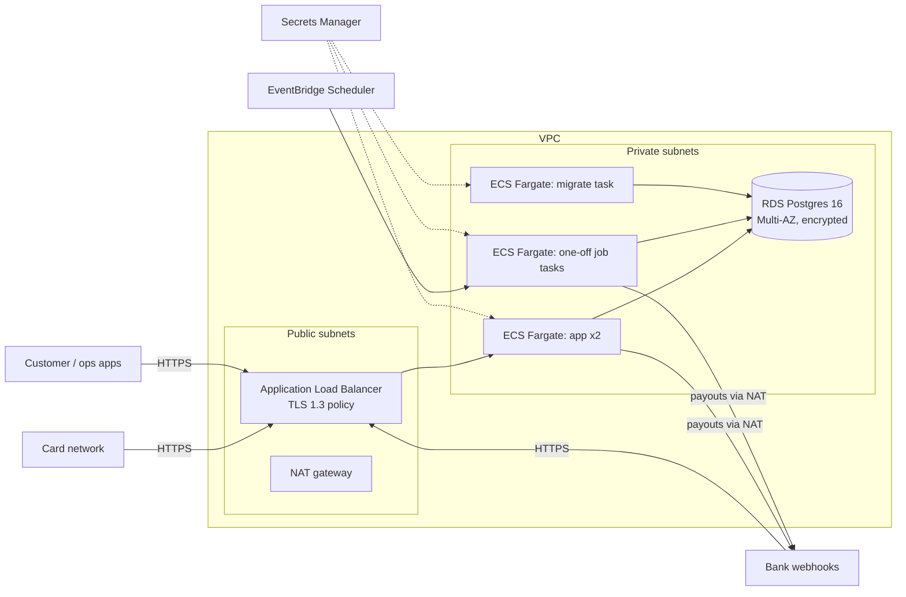

# Deployment (AWS)

The Terraform in `infra/terraform/` describes one environment. CI runs
`terraform fmt -check`, `init -backend=false` and `validate` on every push.
This repo never runs `terraform apply`.

## What it creates

| File | Resources |
|---|---|
| `network.tf` | VPC, 2 public + 2 private subnets in 2 AZs, internet gateway, one NAT gateway, security groups (ALB → tasks :3000 → RDS :5432 only) |
| `database.tf` | RDS Postgres 16, Multi-AZ, gp3 encrypted, private, `rds.force_ssl`, 14-day backups, deletion protection, final snapshot |
| `secrets.tf` | Generated secrets in Secrets Manager: app and owner DB URLs, app DB password, JWT, network key, bank HMAC secret |
| `ecs.tf` | ECR (immutable tags, scan on push), log group, cluster, IAM roles, three task definitions from one image (`app`, `migrate`, `jobs`), ALB with HTTPS listener, API service with circuit-breaker rollback |
| `jobs.tf` | EventBridge Scheduler: `expire-holds` every 15 min, `send-payouts` and `progress-closures` hourly, `reconcile` daily; an alarm when any job logs `job failed`, sent to an encrypted SNS topic (`alerts_topic_arn` output; optional `alert_email`) |
| `tests/guards.tftest.hcl` | `terraform test` with mocked providers (no AWS access): the alarm has an action, the database is private and encrypted, and a secret-looking key in `app_config` is refused |

## Least privilege, end to end

- The API and job tasks get `DATABASE_URL` for the `acme_app` role: no UPDATE
  or DELETE on the ledger and audit tables (LEDGER-04, AUDIT-03).
- Only the migrate task gets the owner URL and the app DB password; it creates
  `acme_app` on the first run (`ensureAppRole`).
- The task role has no AWS permissions: the code talks to Postgres and HTTP only.
- The execution role reads exactly this service's secrets.
- Nothing listens on plain HTTP; tasks and the database have no public IP.
- `app_config` becomes plain-text task environment, so a validation rule refuses any key that looks like a secret (`SECRET`, `PASSWORD`, `TOKEN`, `KEY`, `DATABASE_URL`, `CREDENTIAL`).
- The image builds from a base pinned by digest, so one commit always builds the same image. CI builds it on every push.

## Release

1. Build the image for `linux/arm64` (the task definitions use Graviton) and push it to ECR with an immutable tag.
2. `terraform apply -var image_tag=<tag>` registers new task definitions.
3. Run the `migrate` task once (`aws ecs run-task`, the `migrate_task_definition` output). Migrations are additive and checksummed, so the old API keeps working against the new schema.
4. The API service rolls to the new task definition. The circuit breaker rolls back a deploy whose tasks fail the `/health` check.

## Trade-offs to know

- **Secrets in state.** Terraform generates the passwords, so they are in the
  state file. The `s3` backend block (commented in `versions.tf`) must point at
  an encrypted, versioned bucket with locking and tight access. The other
  option is RDS-managed master passwords plus a rotation Lambda; more moving
  parts for a first environment.
- **One NAT gateway.** Cheap for staging; one AZ outage cuts outbound calls
  (payouts to the bank). Production should run one per AZ.
- **Jobs as one-off tasks, not a worker.** Every job is an idempotent step under
  the account lock, so a missed or overlapping run is safe. Nothing retries a
  failed run except the next tick.
- **What is not here.** WAF and rate limiting in front of the ALB, a
  private link or IP allow-list for the card network and the bank, KMS
  customer-managed keys, and cross-region backups. Each is a short addition
  once the partners' requirements are known.
