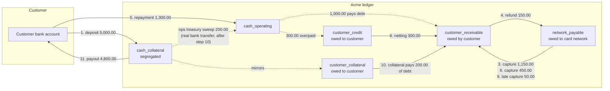

# Money flow: one account from deposit to close

This page follows one account through its whole life with real numbers, and
shows every ledger entry the service writes on the way. All amounts are MXN.

**This page is executable.** `test/docs/money-flow.test.ts` replays the same
steps against the real service and Postgres, then compares the result with the
tables below: every journal line of every step, the balances after each step,
and the final totals. If the code or this page changes on its own, the test
fails. Tables checked by the test carry a hidden `<!-- check: … -->` marker.

Conventions (see [architecture §5](architecture.md)):

- Double entry: the debits of each journal equal its credits, so the ledger always sums to zero.
- `customer_*` accounts belong to this account; the others are Acme's system accounts.
- `customer_collateral` and `customer_credit` are liabilities (money Acme owes the customer).
  `customer_receivable` is an asset (money the customer owes Acme).
- A hold (an authorization) never writes to the ledger.

## The picture



```mermaid
sequenceDiagram
  participant C as Customer
  participant B as Bank (SPEI)
  participant S as Acme service
  participant N as Card network
  C->>S: 0. open account (payout CLABE)
  B->>S: 1. transfer.received 5,000.00 (collateral ref)
  N->>S: 2. authorize 1,200.00 (hold)
  N->>S: 3. capture 1,150.00 (releases the hold)
  N->>S: 4. refund 150.00
  B->>S: 5. transfer.received 1,300.00 (repayment ref)
  N->>S: 6. authorize + capture 450.00 (credit nets)
  C->>S: 7. freeze; a purchase is declined; unfreeze
  C->>S: 8. close
  N->>S: 9. late capture 50.00
  S->>S: 10. 30 days later: settle (collateral pays debt)
  S->>B: payout 4,800.00
  B->>S: 11. payout.completed
  S->>S: 12. closed
```

## Step by step

### Step 0: the customer opens the account

The account starts in `pending_collateral` with an inactive card, a collateral
reference and a repayment reference. No money moves.

<!-- check: ledger step=0 -->
No journal entry.

### Step 1: 5,000.00 arrives at the collateral reference

The bank sends a signed `transfer.received`. The amount is at or above the
minimum, so the account and the card become active with a 1:1 credit limit.
The cash sits in the segregated collateral bank account.

<!-- check: ledger step=1 -->
| Journal | Ledger account | Debit | Credit |
|---|---|---|---|
| deposit | cash_collateral | 5,000.00 | |
| deposit | customer_collateral | | 5,000.00 |

### Step 2: the card network authorizes a 1,200.00 purchase

Under the account row lock: 1,200.00 ≤ 5,000.00 available, so the service
approves and creates a hold. Available credit drops; the ledger does not move.

<!-- check: ledger step=2 -->
No journal entry.

### Step 3: the purchase is captured for 1,150.00

The final amount is smaller than the hold (for example, a gas station pre-auth).
The capture releases the whole hold and posts what was really spent.

<!-- check: ledger step=3 -->
| Journal | Ledger account | Debit | Credit |
|---|---|---|---|
| capture | customer_receivable | 1,150.00 | |
| capture | network_payable | | 1,150.00 |

### Step 4: the merchant refunds 150.00

A refund pays open debt first.

<!-- check: ledger step=4 -->
| Journal | Ledger account | Debit | Credit |
|---|---|---|---|
| refund | network_payable | 150.00 | |
| refund | customer_receivable | | 150.00 |

### Step 5: the customer repays 1,300.00, 300.00 more than owed

The repayment reference tells the service this is a repayment. 1,000.00 pays
the debt; the 300.00 excess becomes credit. Credit never raises available
credit above the limit (SPEND-12).

<!-- check: ledger step=5 -->
| Journal | Ledger account | Debit | Credit |
|---|---|---|---|
| repayment | cash_operating | 1,300.00 | |
| repayment | customer_receivable | | 1,000.00 |
| repayment | customer_credit | | 300.00 |

### Step 6: a 450.00 purchase is authorized and captured

The capture posts 450.00 of debt. No payout has taken the 300.00 credit yet, so
it pays part of the new debt at once (PAYOUT-10). 150.00 stays owed.

<!-- check: ledger step=6 -->
| Journal | Ledger account | Debit | Credit |
|---|---|---|---|
| capture | customer_receivable | 450.00 | |
| capture | network_payable | | 450.00 |
| credit_netting | customer_credit | 300.00 | |
| credit_netting | customer_receivable | | 300.00 |

### Step 7: the customer freezes the card, then unfreezes it

The customer misplaces the card and freezes the account. A purchase is
declined with `account_frozen`. The customer finds the card and unfreezes it.
Freeze and unfreeze only change the account status (and who froze it): they
write no journal entry, and they move no money. A capture, refund or repayment
would still have posted while the account was frozen (FREEZE-02).

<!-- check: ledger step=7 -->
No journal entry.

### Step 8: the customer closes the account

The account moves to `closing` and the card is blocked: every new authorization
is declined from now on. The debt stays; nothing is paid back yet.

<!-- check: ledger step=8 -->
No journal entry.

### Step 9: a late 50.00 capture arrives

A capture cannot be refused (SPEND-06): the network already paid the merchant.
It posts even though the account is closing.

<!-- check: ledger step=9 -->
| Journal | Ledger account | Debit | Credit |
|---|---|---|---|
| capture | customer_receivable | 50.00 | |
| capture | network_payable | | 50.00 |

### Step 10: 30 days later, the closure job settles the account

The late-capture window has passed and no hold is open, so the account moves to
`settling`. The collateral pays the 200.00 debt first (CLOSE-04, CLOSE-06). Then
the job requests a payout of the remaining 4,800.00 from the collateral account.
A payout moves nothing in the ledger until the bank confirms it (PAYOUT-05).

**The four lines and the treasury sweep.** The journal moves 200.00 from
`cash_collateral` to `cash_operating`, but no bank transfer happens here: the
200.00 is still in the segregated collateral bank account. Ops closes that gap
with a **treasury sweep**, a real transfer of 200.00 from the collateral bank
account to the operating bank account. Until the sweep, the collateral account's
bank statement shows 200.00 more than `cash_collateral` in the ledger, and the
operating account 200.00 less than `cash_operating`. This is the same kind of gap
that M6 refused for credit netting (D-M6-1); here it is accepted because the
collateral must cover the debt, and the sweep closes it (D-MF-1).

<!-- check: ledger step=10 -->
| Journal | Ledger account | Debit | Credit |
|---|---|---|---|
| collateral_application | customer_collateral | 200.00 | |
| collateral_application | cash_operating | 200.00 | |
| collateral_application | customer_receivable | | 200.00 |
| collateral_application | cash_collateral | | 200.00 |

### Step 11: the bank confirms the 4,800.00 payout

<!-- check: ledger step=11 -->
| Journal | Ledger account | Debit | Credit |
|---|---|---|---|
| collateral_payout | customer_collateral | 4,800.00 | |
| collateral_payout | cash_collateral | | 4,800.00 |

### Step 12: the closure job closes the account

Debt, holds, collateral and credit are all zero and no payout is open
(CLOSE-05, PAYOUT-07), so the account is `closed`.

<!-- check: ledger step=12 -->
No journal entry.

## Balances after each step

"Available" is what a new authorization could use: limit − debt − holds. From
step 8 on, every authorization is declined because of the account status, not
the amount.

<!-- check: balances -->
| Step | Status | Collateral (limit) | Held | Debt | Credit | Available |
|---|---|---|---|---|---|---|
| 0 | pending_collateral | 0.00 | 0.00 | 0.00 | 0.00 | 0.00 |
| 1 | active | 5,000.00 | 0.00 | 0.00 | 0.00 | 5,000.00 |
| 2 | active | 5,000.00 | 1,200.00 | 0.00 | 0.00 | 3,800.00 |
| 3 | active | 5,000.00 | 0.00 | 1,150.00 | 0.00 | 3,850.00 |
| 4 | active | 5,000.00 | 0.00 | 1,000.00 | 0.00 | 4,000.00 |
| 5 | active | 5,000.00 | 0.00 | 0.00 | 300.00 | 5,000.00 |
| 6 | active | 5,000.00 | 0.00 | 150.00 | 0.00 | 4,850.00 |
| 7 | active | 5,000.00 | 0.00 | 150.00 | 0.00 | 4,850.00 |
| 8 | closing | 5,000.00 | 0.00 | 150.00 | 0.00 | 4,850.00 |
| 9 | closing | 5,000.00 | 0.00 | 200.00 | 0.00 | 4,800.00 |
| 10 | settling | 4,800.00 | 0.00 | 0.00 | 0.00 | 4,800.00 |
| 11 | settling | 0.00 | 0.00 | 0.00 | 0.00 | 0.00 |
| 12 | closed | 0.00 | 0.00 | 0.00 | 0.00 | 0.00 |

## Where the money ended up

Sum of every line this account wrote, per ledger account (debit positive):

<!-- check: totals -->
| Ledger account | Balance |
|---|---|
| customer_collateral | 0.00 |
| customer_receivable | 0.00 |
| customer_credit | 0.00 |
| cash_collateral | 0.00 |
| cash_operating | 1,500.00 |
| network_payable | -1,500.00 |

Read it like this: every customer account is back to zero, so Acme owes the
customer nothing and the customer owes Acme nothing. The collateral account is
empty: 5,000.00 came in, 200.00 paid debt, 4,800.00 went back. Operating cash
holds 1,500.00, exactly what Acme owes the card network for the customer's net
purchases (1,150.00 − 150.00 + 450.00 + 50.00). The sum of the column is zero.

These are **ledger** balances. At the bank, 200.00 of that operating cash still
sits in the collateral account until ops runs the treasury sweep (step 10). The
freeze in step 7 appears nowhere in this table: it moved no money.
